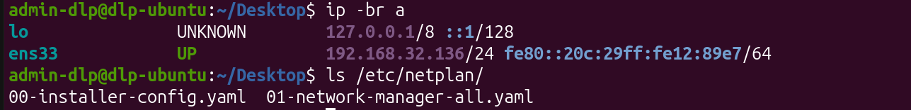
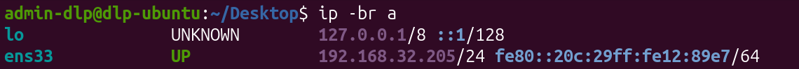
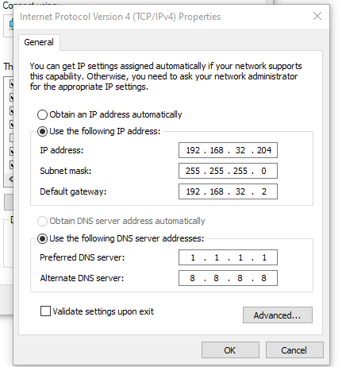
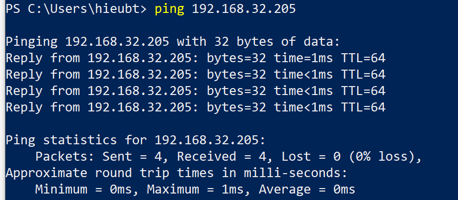
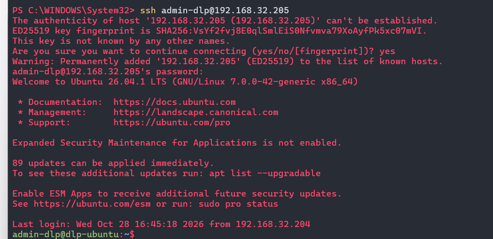

# Setup Vmware

- Để thực hành bài này, mình dùng VMware để tạo 2 máy ảo gồm Ubuntu 22.04 và Windows 10
- Cả hai máy đều dùng card mạng NAT(NMnet8) để kết nối với nhau và có thể truy cập được Internet.
- Mình sử dụng dải mạng `192.168.32.0/24` và đặt IP tĩnh cho từng máy: 
 
| Máy ảo              | Địa chỉ IP       | Subnet Mask     | Gateway        | DNS                  |
| ------------------- | ---------------- | --------------- | -------------- | -------------------- |
| Ubuntu (Server)     | `192.168.32.205` | `255.255.255.0` | `192.168.32.2` | `1.1.1.1`, `8.8.8.8` |
| Windows 10 (Client) | `192.168.32.204` | `255.255.255.0` | `192.168.32.2` | `1.1.1.1`, `8.8.8.8` |

## Cấu hình IP tĩnh

### 1. Ubuntu

- Mở Terminal để kiểm tra card mạng và file cấu hình:
```cmd
ip -br a
ls /etc/netplan
```


- Mở file Netplan để chỉnh sửa 
```cmd
sudo nano /etc/netplan/00-installer-config.yaml
```
- Cấu hình IP tĩnh cho Ubuntu 
```cmd 
network:
  version: 2
  ethernets:
    ens33:
      dhcp4: false
      addresses: [192.168.32.205/24]
      routes:
        - to: default
          via: 192.168.32.2
      nameservers:
        addresses: [1.1.1.1, 8.8.8.8]
```
- Lưu file, áp dụng cấu hình và kiểm tra IP:
```cmd
sudo netplan apply
```


---
### 2. Windows 10

- Nhấn `Win + R`, nhập `ncpa.cpl`.
- Chọn `Ethernet` → `Properties` → `Internet Protocol Version 4 (TCP/IPv4)`.


- Windows VM ping Ubuntu 192.168.32.205 thành công.

- Host Windows (máy thật) SSH vào Ubuntu thành công.


---
## Các Port dùng trong lab 

Có, nên thêm vào phần Setup VMware, nhưng viết ngắn gọn giống văn của bạn. Phần này chỉ giới thiệu các cổng sẽ dùng trong lab, chưa cần cấu hình hết.

### 3. Các cổng sử dụng trong lab

| Kết nối                        | Cổng       | Mục đích                 |
| ------------------------------ | ---------- | ------------------------ |
| Host → Ubuntu                  | 22         | SSH và chuyển source     |
| Windows → Wazuh Manager        | 1514, 1515 | Gửi sự kiện từ Agent     |
| Windows/Host → Wazuh Dashboard | 443        | Truy cập giao diện Wazuh |
| Windows → Squid                | 3128       | Kết nối Proxy            |
| API → Wazuh API                | 55000      | Giao tiếp với Wazuh      |
| API → Wazuh Indexer            | 9200       | Truy vấn dữ liệu         |
| Squid → ICAP                   | 1344       | Kiểm tra nội dung        |
| Host → API riêng               | 5000       | Truy cập qua SSH Tunnel  |
| Ubuntu → Telegram              | 443        | Gửi thông báo            |

- Trên Ubuntu, kiểm tra tường lửa bằng lệnh:
```cmd
sudo ufw status numbered
```
**Kết quả**: inactive, tường lửa UFW chưa được bật nên chưa cần cấu hình các cổng. Các cổng cần thiết sẽ được kiểm tra và cấu hình ở những bước tiếp theo.