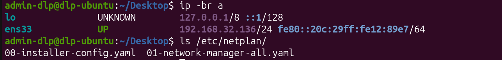
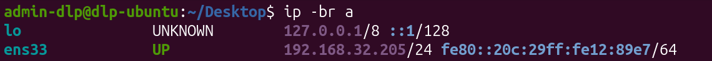
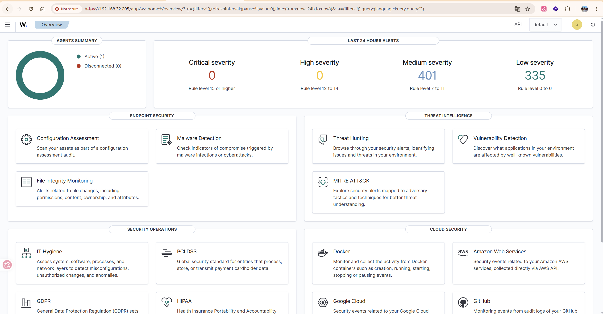

# Wazuh
- Cài **Wazuh** trên Ubuntu như một giải pháp **SIEM (Security Information and Event Management)**, bao gồm ba thành phần chính: `Wazuh Manager`, `Wazuh Indexer` và `Wazuh Dashboard`.
- Hệ thống được triển khai trên Ubuntu nhằm thu thập, giám sát, phân tích và quản lý các event. 

## Cấu hình 

- Cài công cụ và tải **Wazuh**
```bash
sudo apt update
sudo apt install -y curl ca-certificates unzip
mkdir -p ~/dlp-install
cd ~/dlp-install
curl -fLO https://packages.wazuh.com/4.14/wazuh-install.sh
```
- Tạo file cấu hình:
```bash
nano config.yml
```
```bash
nodes:
  # Wazuh Indexer
  indexer:
    - name: wazuh-indexernodes
      ip: 192.168.32.205

  # Wazuh Manager
  server:
    - name: wazuh-managernodes
      ip: 192.168.32.205

  # Wazuh Dashboard
  dashboard:
    - name: wazuh-dashboard
      ip: 192.168.32.205
```

---
## Cài đặt 
- Tạo file cấu hình và chứng thư
```bash
sudo bash wazuh-install.sh --generate-config-files
```
- Cài Indexer
```bash
sudo bash wazuh-install.sh --wazuh-indexer wazuh-indexernodes
```
- Khởi tạo cluster
```bash
sudo bash wazuh-install.sh --start-cluster
```
- Cài Manager
```bash
sudo bash wazuh-install.sh --wazuh-server wazuh-managernodes
```
- Cài Dashboard
```bash
sudo bash wazuh-install.sh --wazuh-dashboard wazuh-dashboard
```


---
## Kiểm tra
- Kiểm tra trạng thái các dịch vụ của Wazuh:
```bash
sudo systemctl is-active wazuh-manager wazuh-indexer wazuh-dashboard filebeat
```



- Kiểm tra kết nối Filebeat đến Wazuh Indexer:
```bash
sudo filebeat test output
```

Từ máy host (Windows ngoài máy thật), truy cập https://192.168.32.205 và đăng nhập Wazuh Dashboard thành công.

