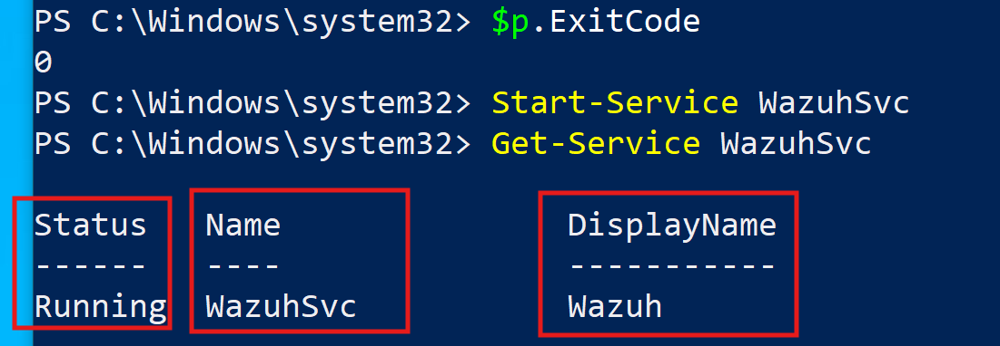
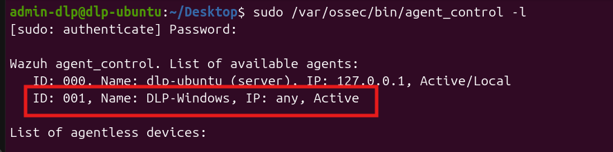
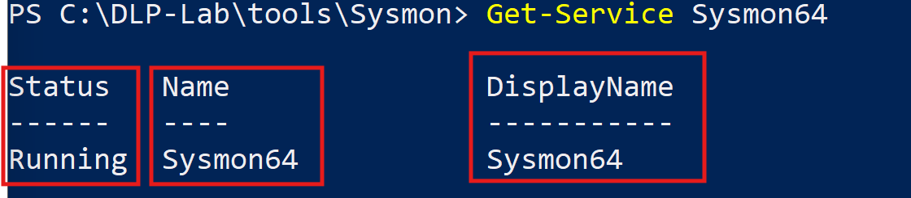
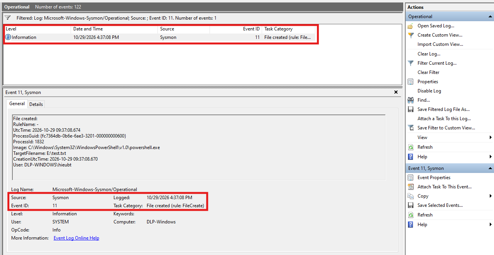

# Windows Agent & Sysmon
- Cài đặt **Wazuh Agent** và **Sysmon** trên máy `Windows VM` (192.168.32.204)
- Mục đích: thu thập và gửi các event từ `Windows` về `Wazuh Manager` (192.168.32.205)
---
## Config Wazuh Agent
- Mở `PowerShell Administrator`, tải và cài `Wazuh Agent`
```cmd
New-Item -ItemType Directory -Force C:\DLP-Lab\tools | Out-Null

Invoke-WebRequest 'https://packages.wazuh.com/4.x/windows/wazuh-agent-4.3.11-1.msi' -OutFile C:\DLP-Lab\tools\wazuh-agent.msi
```

- Cài đặt Agent và kết nối với `Manager`
```cmd
$p = Start-Process msiexec.exe -ArgumentList '/i "C:\DLP-Lab\tools\wazuh-agent.msi" /qn WAZUH_MANAGER="192.168.32.205" WAZUH_REGISTRATION_SERVER="192.168.32.205" WAZUH_AGENT_NAME="DLP-Windows"' -Wait -PassThru

$p.ExitCode
```

- Cài đặt Wazuh Agent thành công với ExitCode = 0
- Khởi động và kiểm tra Agent
```cmd
Start-Service WazuhSvc
Get-Service WazuhSvc
```

---

## Kiểm tra Agent
- Trên Ubuntu, kiểm tra Agent đã kết nối: 
```cmd
sudo /var/ossec/bin/agent_control -l
```



- Agent DLP-Windows có ID 001, trạng thái Active, kết nối thành công với Wazuh Manager
---

## Cài đặt Sysmon
- Tải Sysmon từ [Microsoft Sysinternals](https://learn.microsoft.com/en-us/sysinternals/downloads/sysmon)
- Giải nén vào **C:\DLP-Lab\tools\Sysmon**
-  Cấu hình file `sysmon_dlp.xml` trong `source/windows/sysmon/` để theo dõi việc tạo file trên **USB**.
- Mở **PowerShell Administrator**:
```cmd
cd C:\DLP-Lab\tools\Sysmon
.\Sysmon64.exe -s
.\Sysmon64.exe -accepteula -i .\sysmon_dlp.xml
Get-Service Sysmon64
```


---

## Kiểm tra Sysmon
- Kết nối **USB Meow (E:)** vào máy ảo Windows 10
- Áp dụng cấu hình Sysmon 
```cmd
cd C:\DLP-Lab\tools\Sysmon
.\Sysmon64.exe -c .\sysmon_dlp.xml
```

- Tạo file `test.txt` trên **USB** để kiểm tra 
- Mở **Event Viewer**:

`Applications and Services Logs` → `Microsoft` → `Windows` → `Sysmon` → `Operational`

- Sau đó lọc **Event ID 11 (FileCreate)** để kiểm tra event tạo file trên USB



