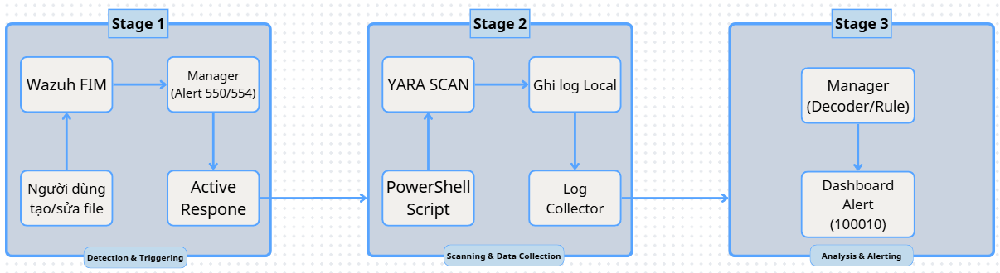
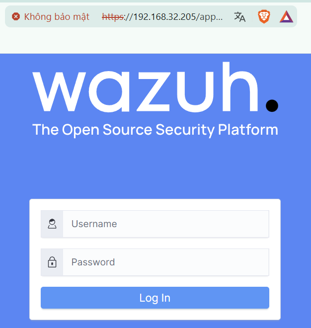
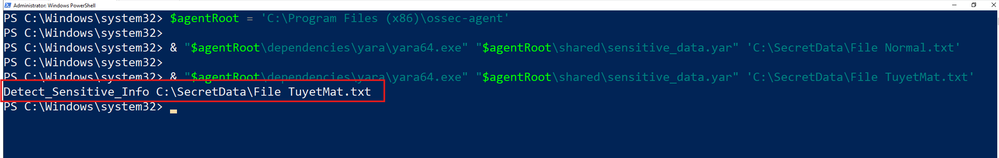
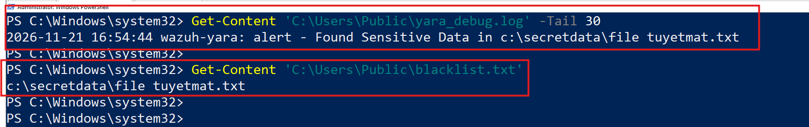
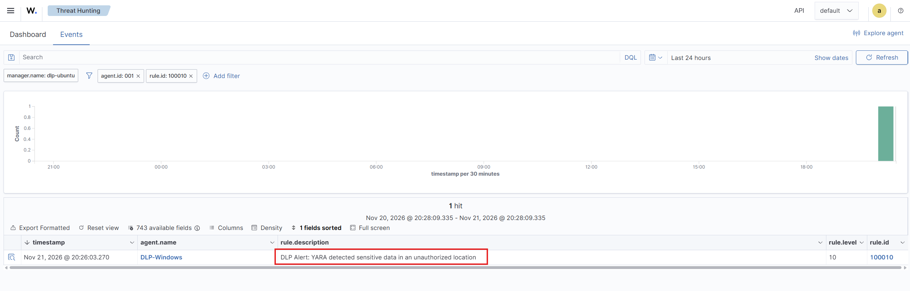

# FIM, YARA & Active Response
- Cấu hình FIM để giám sát thay đổi file trên Windows
- Sử dụng YARA để phát hiện dữ liệu nhạy cảm
- Cấu hình Active Response để tự động thực thi script khi phát hiện sự kiện
- Gửi log và cảnh báo về Wazuh Dashboard



---

## Cài đặt YARA
- Các file source nằm trong [windows](../source/windows) của repository. 
- Chuyển source vào Windows VM (192.168.32.204) tại `C:\DLP-Lab\repo\source\windows`
- Tải **YARA v4.5.5** từ [Github](https://github.com/VirusTotal/yara/releases/tag/v4.5.5).
- Giải nén yara64.exe, yarac64.exe và các DLL đi kèm vào `C:\Program Files (x86)\ossec-agent\dependencies\yara`
- Mở **PowerShell Administrator**, tạo thư mục và copy source vào **Wazuh Agen**:
```powershell
$agentRoot = 'C:\Program Files (x86)\ossec-agent'
$repoRoot = 'C:\DLP-Lab\repo'

Copy-Item "$repoRoot\source\windows\yara\sensitive_data.yar" "$agentRoot\shared"

Copy-Item "$repoRoot\source\windows\active-response\*.ps1" "$agentRoot\shared"

Copy-Item "$repoRoot\source\windows\active-response\*.bat" "$agentRoot\active-response\bin"

Copy-Item "$repoRoot\source\windows\active-response\*.cmd" "$agentRoot\active-response\bin"
```

---
## Cấu hình FIM trên Windows
- Trên **Windows VM (192.168.32.204)**, mở **PowerShell Administrator**
- Sao lưu và mở cấu hình Wazuh Agent:
```powershell
$agentRoot = 'C:\Program Files (x86)\ossec-agent'

Copy-Item "$agentRoot\ossec.conf" "$agentRoot\ossec.conf.before-dlp"

notepad "$agentRoot\ossec.conf"
```

-  File [Cấu hình Wazuh Agent](../source/wazuh-agent-ossec.fragment.xml)

- Tìm block `<syscheck>` đã có, bật FIM theo dõi thư mục C:\SecretData:
```notepad
<disabled>no</disabled>
<directories realtime="yes" check_all="yes">C:\SecretData</directories>
<frequency>43200</frequency>
<scan_on_start>yes</scan_on_start>
```

- Ghép các block `<localfile>` từ fragment vào ossec.conf để thu thập:
    - Log YARA: C:\Users\Public\yara_debug.log
    - Log Active Response
    - Sự kiện Sysmon

- Không tạo cấu hình trùng. Giữ nguyên địa chỉ Wazuh Manager 192.168.32.205.

- Lưu file và khởi động lại Wazuh Agent:
```powershell
Restart-Service WazuhSvc

Get-Service WazuhSvc

Get-Content "$agentRoot\ossec.log" -Tail 40
```

---
## Cấu hình Wazuh Manager
- Trên **Ubuntu VM (192.168.32.205)**, chuyển hai file [manager-ossec.fragment.xml](../source/wazuh/manager-ossec.fragment.xml) và [local_rules.xml](../source/wazuh/local_rules.xml) vào `~/dlp-source/wazuh/`.
- Sao lưu cấu hình và rules trước khi sửa:
```bash
sudo cp /var/ossec/etc/ossec.conf /var/ossec/etc/ossec.conf.before-dlp
sudo cp /var/ossec/etc/rules/local_rules.xml /var/ossec/etc/rules/local_rules.xml.before-dlp
```
- Ghép vào `ossec.conf`: 8 block `<command>`, 8 block `<active-response>` và `<syscheck><disabled>yes</disabled></syscheck>` để tắt FIM Linux trên Manager.
- Gán quyền chuẩn cho file cấu hình:
```bash
sudo chown root:wazuh /var/ossec/etc/ossec.conf
sudo chmod 640 /var/ossec/etc/ossec.conf
```
- Ghép 9 rule DLP vào `/var/ossec/etc/rules/local_rules.xml`, đặt bên trong group `local,syslog,sshd,` có sẵn. Rule `100015` giới hạn `^E:` phải khớp ký tự ổ USB.
- Kiểm tra cú pháp và khởi động lại Manager:
```bash
sudo /var/ossec/bin/wazuh-analysisd -t; echo "analysisd=$?"
sudo /var/ossec/bin/wazuh-execd -t; echo "execd=$?"
sudo systemctl restart wazuh-manager
sudo systemctl is-active wazuh-manager
```
- Kiểm tra rules và agent sau khi restart:
```bash
sudo grep -c "<rule id=" /var/ossec/etc/rules/local_rules.xml
sudo /var/ossec/bin/agent_control -l
```


---
## Kiểm tra FIM và YARA

- Trên **Windows VM (192.168.32.204)**, mở File Explorer, truy cập `C:\SecretData` và tạo thủ công hai tệp:
  - `File Normal.txt`: Nhập nội dung `Ghi chu lich hoc cua nhom lab.`
  - `File TuyetMat.txt`: Nhập nội dung `TUYỆT MẬT - du lieu gia phuc vu lab.`

- Mở **PowerShell Administrator**, chạy lệnh quét YARA thủ công:

```powershell
$agentRoot = 'C:\Program Files (x86)\ossec-agent'

& "$agentRoot\dependencies\yara\yara64.exe" "$agentRoot\shared\sensitive_data.yar" 'C:\SecretData\File Normal.txt'

& "$agentRoot\dependencies\yara\yara64.exe" "$agentRoot\shared\sensitive_data.yar" 'C:\SecretData\File TuyetMat.txt'
```



- **Kết quả:** `File Normal.txt` không khớp rule, `File TuyetMat.txt` khớp `Detect_Sensitive_Info`.

- Mở `File TuyetMat.txt` bằng Notepad, thêm dòng `TUYỆT MẬT lan 2`, sau đó nhấn **Ctrl + S** để lưu, tạo sự kiện thay đổi tệp cho FIM.

- Kiểm tra log YARA và blacklist bằng PowerShell:

```powershell
Get-Content 'C:\Users\Public\yara_debug.log' -Tail 30

Get-Content 'C:\Users\Public\blacklist.txt'
```


- Trên **Wazuh Dashboard**, lọc `rule.id:100010` của agent `DLP-Windows`, kiểm tra đường dẫn tệp được phát hiện.



- **Kết quả mong đợi:** FIM phát hiện thay đổi tệp, Active Response tự động gọi YARA quét và cảnh báo rule `100010` xuất hiện trên Dashboard đúng tệp, đúng agent.