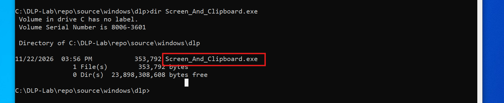
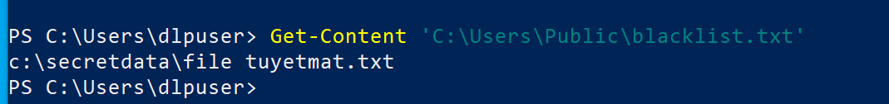
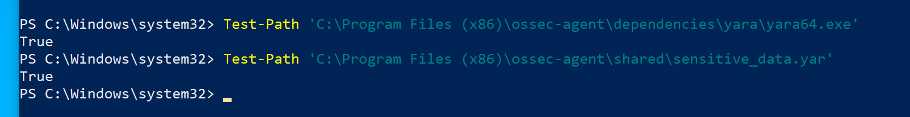
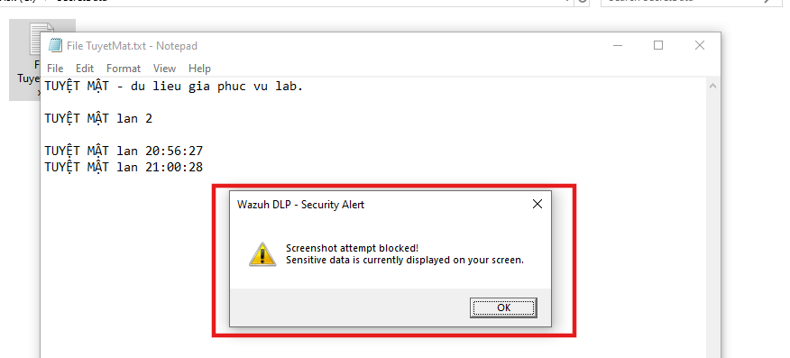
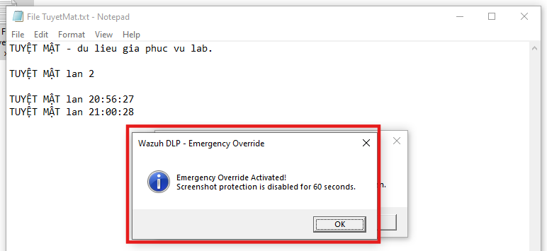
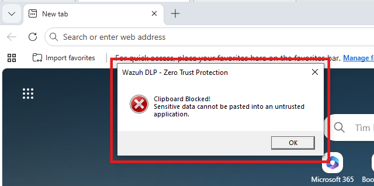
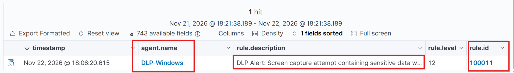
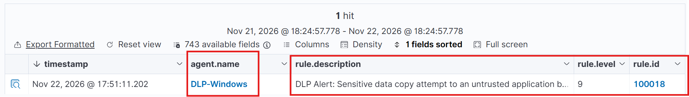

# Windows Guard
- Biên dịch file [Screen_And_Clipboard.cpp](../source/windows/dlp/Screen_And_Clipboard.cpp) thành `Screen_And_Clipboard.exe` bằng MSVC trên Windows VM.
- Chạy Guard trên Windows VM để kiểm soát clipboard và chụp màn hình đối với dữ liệu nhạy cảm.
- Gửi log, cảnh báo về **Wazuh Dashboard** thông qua **Wazuh Agent**.

---
## Biên dịch Guard
- Trên Windows VM, cài **Visual Studio Build Tools** với thành phần **Desktop development with C++** (MSVC và Windows SDK).
- Đưa file [**Screen_And_Clipboard.cpp**](../source/windows/dlp/Screen_And_Clipboard.cpp) vào thư mục `C:\DLP-Lab\repo\source\windows\dlp`, sau đó mở **x64 Native Tools Command Prompt for VS** và chạy:

```bat
cd /d C:\DLP-Lab\repo\source\windows\dlp
cl /nologo /std:c++17 /EHsc /utf-8 Screen_And_Clipboard.cpp /Fe:Screen_And_Clipboard.exe user32.lib shell32.lib
```

- Kiểm tra file sau khi biên dịch:
```powershell
dir Screen_And_Clipboard.exe
```


---
## Kiểm tra blacklist và YARA
- **Blacklist** được cập nhật từ cơ chế **Active Response** ở bước trước. Kiểm tra nội dung:
```powershell
Get-Content 'C:\Users\Public\blacklist.txt'
```


- Kiểm tra YARA và file rule:
```powershell
Test-Path 'C:\Program Files (x86)\ossec-agent\dependencies\yara\yara64.exe'
Test-Path 'C:\Program Files (x86)\ossec-agent\shared\sensitive_data.yar'
```


---
## Chạy Guard
- Mở PowerShell **trong desktop Windows VM** (không chạy qua SSH/Remoting) và chạy:
```powershell
cd 'C:\DLP-Lab\repo\source\windows\dlp'
.\Screen_And_Clipboard.exe
```

- Kiểm tra hai trường hợp:

    - **File nhạy cảm:** mở `C:\SecretData\File TuyetMat.txt` bằng double-click để Notepad hiển thị tên file trên tiêu đề.

    - Nhấn `PrtScr` hoặc `Win + Shift + S` → Guard hiện hộp thoại **Screenshot attempt blocked!**

    

    - **Lưu ý:** chặn 5 lần trong 20 giây (hoặc copy nhạy cảm 10 lần trong 30 giây) sẽ kích hoạt override 60 giây.

    

    - Bôi đen một đoạn bất kỳ (không cần copy toàn bộ file), `Ctrl+C`, rồi `Ctrl+V` vào ô nhập của trình duyệt → hiện hộp thoại **Clipboard Blocked!**.

    

    - **File thường:** mở `C:\SecretData\File Normal.txt` và làm lại các thao tác trên → không bị chặn.

---
## Kiểm tra log trên Wazuh
- Truy cập **Wazuh Dashboard** tại `https://192.168.32.205`
- Vào **Threat Hunting** → **Events**  và lọc:
    - `agent.name: DLP-Windows`
    - `rule.id: 100011` — chặn chụp màn hình
    - `rule.id: 100018` — chặn clipboard
    - `rule.id: 100012`, `rule.id: 100019` — override



