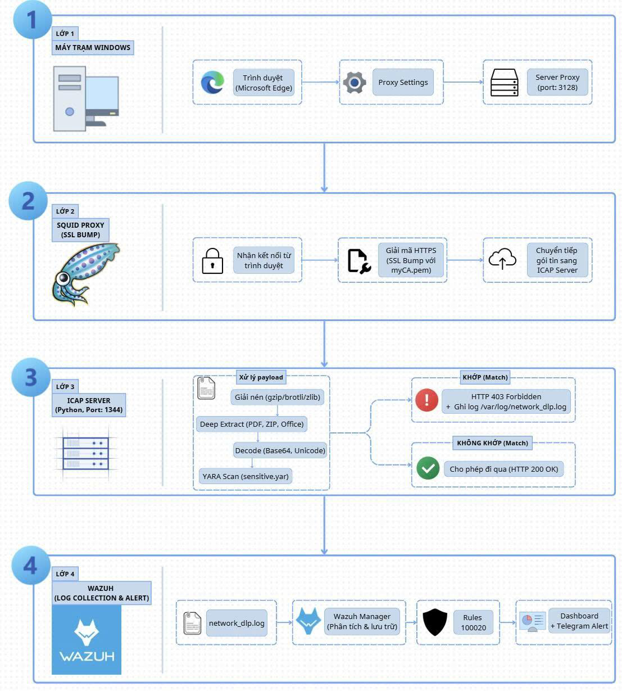
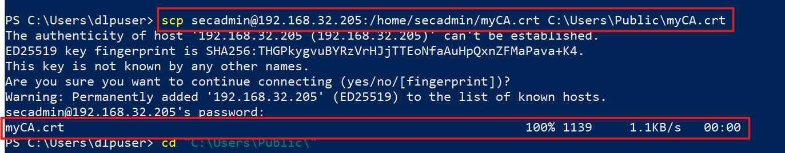
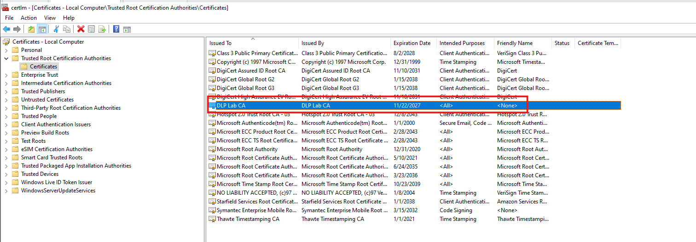
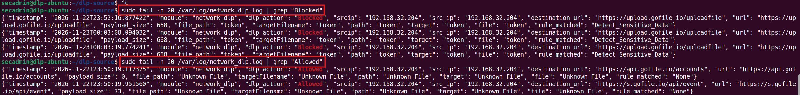
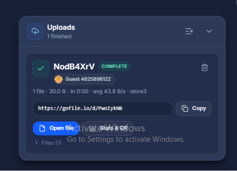
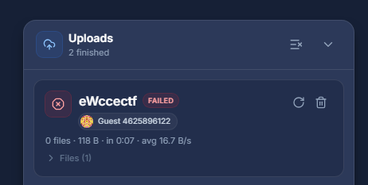
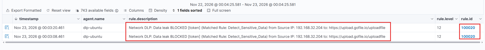

# SQUID & ICAP
- Dựng **Squid** làm proxy trên Ubuntu để lưu lượng HTTP/HTTPS của Windows VM qua bộ quét
- Dựng **ICAP server** dùng **YARA** để kiểm tra nội dung upload và quyết định cho qua/chặn
- Gửi log `Blocked` về **Wazuh Dashboard** qua rule id `100020`



---
## Chuẩn bị source và ICAP
- Chuyển các file sau vào Ubuntu tại `~/dlp-source`:
    - [icap-server](../source/icap/icap_server.py), [sensitive.yar](../source/icap/sensitive.yar)
    - [squid.conf](../source/proxy/squid.conf), [whitelist.txt](../source/proxy/whitelist.txt)
    - [dlp-icap.service](../source/deploy/dlp-icap.service), [icap.env.example](../source/deploy/icap.env.example)

- Cài package:
```bash
sudo apt update
sudo apt install -y python3 python3-venv python3-dev build-essential libyara-dev p7zip-full squid-openssl openssl
```

- Tạo user `dlp`, thư mục và venv:
```bash
id dlp || sudo useradd --system --home /opt/dlp --shell /usr/sbin/nologin dlp

sudo install -d -m 750 -o root -g dlp /etc/dlp
sudo install -d -m 750 -o dlp -g dlp /var/lib/dlp

sudo mkdir -p /opt/dlp/repo/source
sudo cp -r ~/dlp-source/icap ~/dlp-source/proxy ~/dlp-source/deploy /opt/dlp/repo/source/

sudo python3 -m venv /opt/dlp/venv
sudo /opt/dlp/venv/bin/python -m pip install pyicap==1.0b1 Brotli==1.2.0 PyPDF2==3.0.1 yara-python==4.5.4
sudo /opt/dlp/venv/bin/python -m pip check
sudo /opt/dlp/venv/bin/python -c "import pyicap, brotli, PyPDF2, yara; print('deps ok')"
```

- Tạo log và cấp quyền cho Wazuh đọc:
```bash
sudo touch /var/log/network_dlp.log
sudo chown dlp:wazuh /var/log/network_dlp.log
sudo chmod 640 /var/log/network_dlp.log
```

- Cài service ICAP:
```bash
sudo install -m 640 -o root -g dlp /opt/dlp/repo/source/deploy/icap.env.example /etc/dlp/icap.env
sudo install -m 644 /opt/dlp/repo/source/deploy/dlp-icap.service /etc/systemd/system/dlp-icap.service
sudo systemctl daemon-reload
sudo systemctl enable --now dlp-icap
sudo systemctl status dlp-icap --no-pager
sudo ss -lntp | grep 1344
```
- **ICAP** phải lắng nghe trên `127.0.0.1:1344`

---
## Cấu hình Squid và Certificate Authority (CA)
- Tạo CA riêng của lab:
```bash
sudo install -d -m 750 -o root -g proxy /etc/squid/ssl_cert

sudo openssl req -new -newkey rsa:2048 -nodes -x509 -days 365 -sha256 \
  -subj '/CN=DLP Lab CA' \
  -addext 'basicConstraints=critical,CA:TRUE' \
  -addext 'keyUsage=critical,keyCertSign,cRLSign' \
  -keyout /etc/squid/ssl_cert/myCA.key \
  -out /etc/squid/ssl_cert/myCA.crt

sudo sh -c 'cat /etc/squid/ssl_cert/myCA.crt /etc/squid/ssl_cert/myCA.key > /etc/squid/ssl_cert/myCA.pem'
sudo chown root:proxy /etc/squid/ssl_cert/myCA.key /etc/squid/ssl_cert/myCA.pem
sudo chmod 640 /etc/squid/ssl_cert/myCA.key /etc/squid/ssl_cert/myCA.pem

sudo install -d -m 750 -o proxy -g proxy /var/lib/squid

sudo /usr/lib/squid/security_file_certgen -c -s /var/lib/squid/ssl_db -M 4MB
sudo chown -R proxy:proxy /var/lib/squid/ssl_db
```

- Cấu hình Squid và sửa subnet cho đúng lab `192.168.32.0/24`:
```bash
sudo cp /etc/squid/squid.conf /etc/squid/squid.conf.before-dlp
sudo install -m 644 /opt/dlp/repo/source/proxy/squid.conf /etc/squid/squid.conf
sudo install -m 644 /opt/dlp/repo/source/proxy/whitelist.txt /etc/squid/whitelist.txt

sudo sed -i 's|^acl localnet src .*|acl localnet src 192.168.32.0/24|' /etc/squid/squid.conf

sudo squid -k parse
sudo systemctl restart squid
sudo systemctl status squid --no-pager
sudo tail -n 30 /var/log/squid/cache.log
```

- Giữ `whitelist.txt` rỗng: mọi HTTPS đều bị kiểm tra; không thêm domain của dịch vụ upload demo.
- Chỉ chuyển `myCA.crt` sang Windows VM, không chuyển `.key`/`.pem`:
```bash
sudo cp /etc/squid/ssl_cert/myCA.crt /home/secadmin/myCA.crt
sudo chown secadmin:secadmin /home/secadmin/myCA.crt
```

- Từ Windows VM tải chứng thư:
```powershell
scp secadmin@192.168.32.205:/home/secadmin/myCA.crt C:\Users\Public\myCA.crt
```

- Import `myCA.crt` vào **Trusted Root Certification Authorities**:
    1. `Win + R` → `certlm.msc`
    2. Chuột phải **Trusted Root Certification Authorities** → **All Tasks** → **Import**
    3. Chọn `C:\Users\Public\myCA.crt` → Next → Finish


- Kiểm tra fingerprint khớp giữa Windows và Ubuntu:
```powershell
$cert = Get-PfxCertificate C:\Users\Public\myCA.crt
[BitConverter]::ToString([Security.Cryptography.SHA256]::Create().ComputeHash($cert.RawData)).Replace('-', ':')
```

```bash
sudo openssl x509 -in /etc/squid/ssl_cert/myCA.crt -noout -fingerprint -sha256
```
*Hai giá trị phải khớp*

---
## Cấu hình proxy trên Windows
- Cấu hình proxy:
    - Settings → Network & Internet → Proxy → Manual proxy
    - Address: `192.168.32.205`
    - Port: `3128`
- Tắt QUIC trên Edge/Chrome:
    - Edge: `edge://flags/#enable-quic` → **Disabled**
    - Khởi động lại trình duyệt.

- Kiểm tra kết nối tới proxy:
```powershell
Test-NetConnection 192.168.32.205 -Port 3128
```
- Kiểm tra lưu lượng qua proxy:
```bash
sudo tail -f /var/log/squid/access.log
```

- Mở một trang HTTPS bằng trình duyệt. Sẽ thấy những request trong `access.log`

---
## Kiểm tra upload
- Ubuntu, mở hai terminal:
```bash
sudo tail -f /var/log/squid/access.log 
sudo tail -f /var/log/network_dlp.log
```


- Windows VM:
    1. Upload `File Normal.txt` lên gofile.io => thành công
    
    2. Upload `File TuyetMat.txt` lên gofile.io => Không thành công, báo thất bại
    

---
## Kiểm tra trên Wazuh
- Kiểm tra Manager đã đọc log ICAP:
```bash
sudo grep -n -B2 -A3 'network_dlp.log' /var/ossec/etc/ossec.conf
```
Nếu chưa có, thêm vào `/var/ossec/etc/ossec.conf`:
```xml
<localfile>
  <log_format>json</log_format>
  <location>/var/log/network_dlp.log</location>
</localfile>
```
Rồi restart Manager:
```bash
sudo /var/ossec/bin/wazuh-analysisd -t; echo "analysisd=$?"
sudo systemctl restart wazuh-manager
```

- Mở **Wazuh Dashboard** tại `https://192.168.32.205`.
- Vào **Threat Hunting** → **Events**
- Lọc:
```text
rule.id:100020
```
