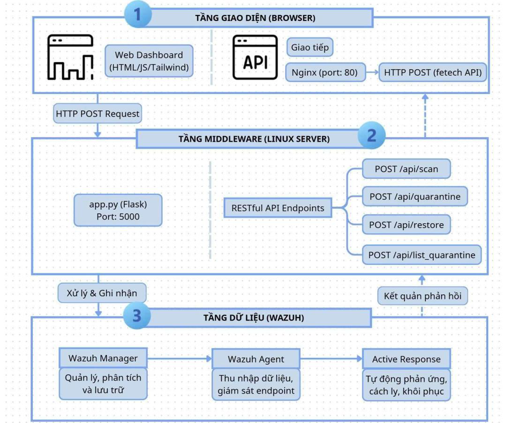
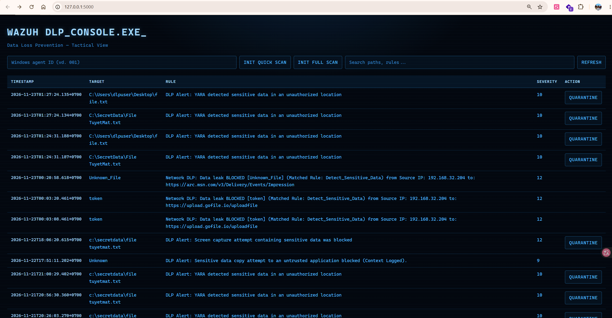
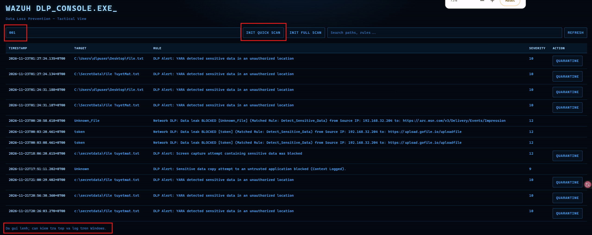
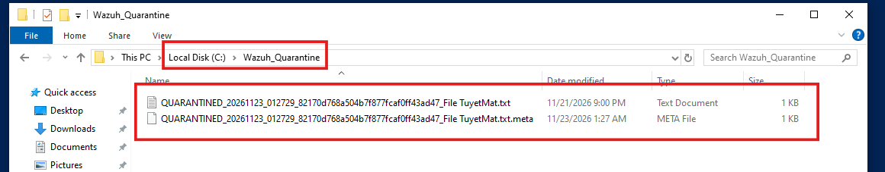

# API & Giao Diện
- API Flask đọc alert DLP từ **Wazuh Indexer**.
- Giao diện gửi `Quick Scan`, `Quarantine`, `Restore` qua **Wazuh API**.
- API bind `127.0.0.1:5000`; host vào qua SSH tunnel.



---
## Chuẩn bị source và môi trường
- Chuyển vào Ubuntu tại `~/dlp-source`:
    - [app.py](../source/dashboard/app.py), [index.html](../source/dashboard/index.html)
    - [dlp-api.service](../source/deploy/dlp-api.service), [api.env.example](../source/deploy/api.env.example)
```bash
sudo mkdir -p /opt/dlp/repo/source
sudo cp -r ~/dlp-source/dashboard ~/dlp-source/deploy /opt/dlp/repo/source/
```
- Cài package:
```bash
sudo /opt/dlp/venv/bin/python -m pip install Flask==3.1.3 requests==2.34.2
sudo /opt/dlp/venv/bin/python -m pip check
```
- `app.py` trong repo đã bỏ field `custom` cho Wazuh 4.14.
- Tạo `/etc/dlp/api.env` và điền:
```bash
sudo install -m 640 -o root -g dlp /opt/dlp/repo/source/deploy/api.env.example /etc/dlp/api.env
sudo nano /etc/dlp/api.env
```
```text
WAZUH_API_URL=https://192.168.32.205:55000
WAZUH_API_USER=wazuh
WAZUH_API_PASSWORD=<mật khẩu user wazuh>

WAZUH_INDEXER_URL=https://192.168.32.205:9200
WAZUH_INDEXER_USER=admin
WAZUH_INDEXER_PASSWORD=<mật khẩu user admin>

QUARANTINE_REGISTRY=/var/lib/dlp/quarantine_registry.json
```
- `wazuh` là tài khoản API, `admin` là tài khoản Indexer. Mật khẩu lấy từ `wazuh-install-files.tar`; không commit file env.

---
## Chạy service
```bash
sudo install -m 644 /opt/dlp/repo/source/deploy/dlp-api.service /etc/systemd/system/dlp-api.service
sudo systemctl daemon-reload
sudo systemctl enable --now dlp-api
sudo systemctl status dlp-api --no-pager

sleep 2
curl --fail http://127.0.0.1:5000/api/alerts
```
- `[]` là chưa có alert; lỗi HTTP không phải danh sách rỗng.
- Lỗi thì xem `sudo journalctl -u dlp-api -n 60 --no-pager`.

---
## Mở giao diện từ host
```powershell
ssh -N -L 5000:127.0.0.1:5000 secadmin@192.168.32.205
```
- Giữ terminal mở, vào `http://127.0.0.1:5000`.



---
## Kiểm tra chức năng
- Nhập Agent ID `001`, bấm **INIT QUICK SCAN**. Dòng trạng thái ở cuối trang hiện `Da gui lenh; can kiem tra tep va log tren Windows.`



- Bấm **QUARANTINE** trên alert có target `c:\secretdata\file tuyetmat.txt`.


