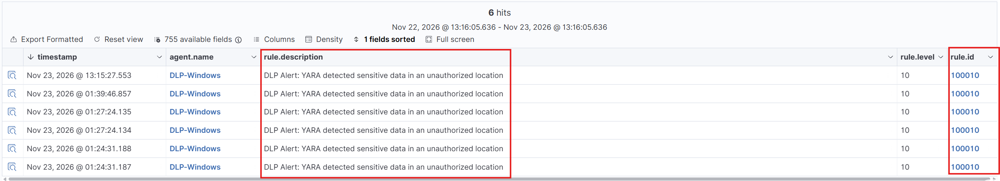
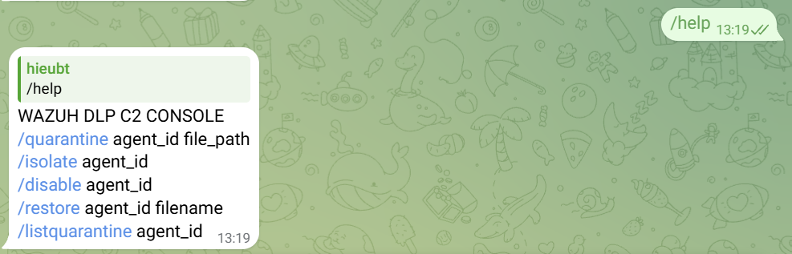
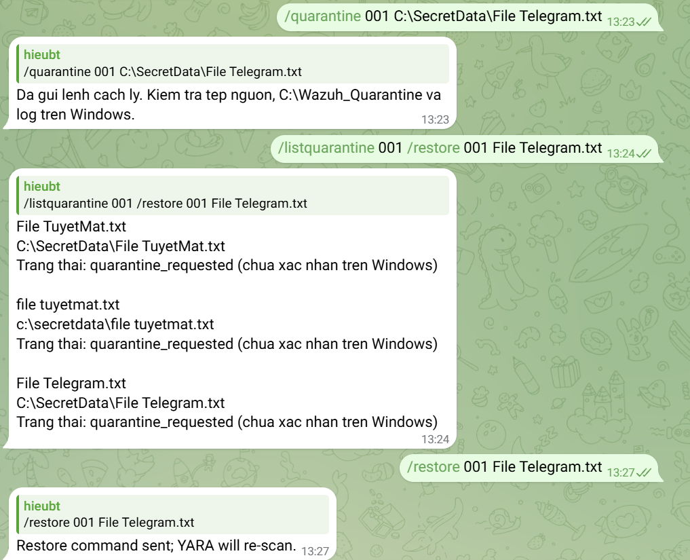
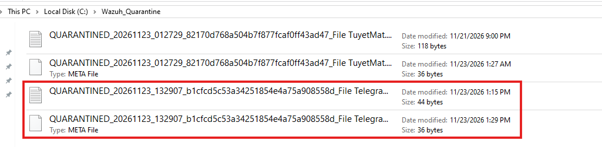
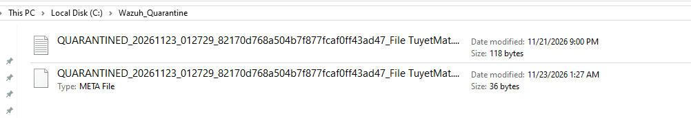

# Bot Telegram

- Tạo bot Telegram nhận cảnh báo DLP từ **Wazuh Manager** qua integration `custom-telegram`.
- Bot nhận lệnh `/quarantine`, `/restore`, `/listquarantine` và gửi tiếp tới **API** ở bước 07.
- Bot chỉ xử lý chat riêng trùng `TELEGRAM_CHAT_ID` trong `/etc/dlp/telegram.env`.

---
## Chuẩn bị source
- Đặt các tệp sau vào `~/dlp-source` trên Ubuntu:
    - `~/dlp-source/telegram/`: [dlp_bot.py](../source/telegram/dlp_bot.py), [custom-telegram](../source/telegram/custom-telegram), [get_chat_id.py](../source/telegram/get_chat_id.py)
    - `~/dlp-source/deploy/`: [telegram.env.example](../source/deploy/telegram.env.example), [dlp-bot.service](../source/deploy/dlp-bot.service)
- Copy source vào `/opt/dlp/repo/source` rồi cài thư viện bot:
```bash
sudo cp -r ~/dlp-source/telegram ~/dlp-source/deploy /opt/dlp/repo/source/
sudo /opt/dlp/venv/bin/python -m pip install pyTelegramBotAPI==4.37.0
sudo /opt/dlp/venv/bin/python -m pip check
```

---
## Tạo bot và lấy chat ID
- Mở **@BotFather**, gửi `/newbot`, đặt tên hiển thị `dlp-bot` và username kết thúc bằng `bot`, ví dụ `dlp_lab_bot`.
- Lưu riêng HTTP API Token.
- Mở chat riêng với bot, bấm `Start` hoặc gửi `/start`.
- Trên Ubuntu, chạy script lấy Chat ID và dán token:
```bash
/opt/dlp/venv/bin/python /opt/dlp/repo/source/telegram/get_chat_id.py
```
- Output ra `Private chat ID`.

---
## Cấu hình môi trường
- Tạo `/etc/dlp/telegram.env` từ file mẫu:
```bash
sudo install -m 640 -o root -g dlp /opt/dlp/repo/source/deploy/telegram.env.example /etc/dlp/telegram.env
sudo nano /etc/dlp/telegram.env
```
- Điền Token và Chat ID lấy ở phần trên vào file:
```text
TELEGRAM_BOT_TOKEN=<TOKEN_MOI>
TELEGRAM_CHAT_ID=<ID_CHAT_RIENG>
MIDDLEWARE_URL=http://127.0.0.1:5000/api
```

---
## Nối cảnh báo từ Wazuh sang Telegram
- Cài script và trỏ shebang về venv:
```bash
sudo install -m 750 -o root -g wazuh /opt/dlp/repo/source/telegram/custom-telegram /var/ossec/integrations/custom-telegram
sudo sed -i '1c\#!/opt/dlp/venv/bin/python' /var/ossec/integrations/custom-telegram
```
- Nạp biến môi trường qua systemd drop-in:
```bash
sudo systemctl edit wazuh-manager
```
Nội dung drop-in:
```ini
[Service]
EnvironmentFile=/etc/dlp/telegram.env
```
- Thêm `<integration>` vào `/var/ossec/etc/ossec.conf`; không khai báo lại `<command>`/`<active-response>` đã có ở bước 04:
```xml
<integration>
  <name>custom-telegram</name>
  <level>3</level>
  <rule_id>100010,100011,100012,100015,100016,100017,100018,100019,100020</rule_id>
  <alert_format>json</alert_format>
</integration>
```

- Trên Windows VM, tạo file test; đối chiếu alert `100010` trên Dashboard với tin Telegram (cùng agent, rule, path, thời gian):
```powershell
Set-Content -Path 'C:\SecretData\File Telegram.txt' -Value 'TUYỆT MẬT - test canh bao Telegram.' -Encoding UTF8
```



---
## Chạy bot nhận lệnh
- Bot gọi API `dlp-api` ở bước 07 qua loopback, nên API phải chạy trước. Cài service và khởi động:
```bash
sudo install -m 644 /opt/dlp/repo/source/deploy/dlp-bot.service /etc/systemd/system/dlp-bot.service
sudo systemctl daemon-reload
sudo systemctl enable --now dlp-bot
sudo systemctl status dlp-bot --no-pager
```
- Service chạy dưới user `dlp`, đọc biến môi trường từ `/etc/dlp/telegram.env`.
- Gửi `/help` trong chat riêng; bot trả danh sách lệnh.



---
## Kiểm tra lệnh
- Gửi từng lệnh thành một tin riêng:
```text
/quarantine 001 C:\SecretData\File Telegram.txt
/listquarantine 001
/restore 001 File Telegram.txt
```
- Bot chỉ trả “đã gửi lệnh”; kiểm tra trên Windows:
    - Sau `/quarantine`: tệp nguồn biến mất; tệp `QUARANTINED_*_File Telegram.txt` và `.meta` nằm trong `C:\Wazuh_Quarantine`.
    - Sau `/restore`: tệp trở lại `C:\SecretData`.
- `/listquarantine` chỉ là lịch sử yêu cầu; không dùng `/isolate`, `/disable` trong demo.


- Tệp cách ly trong C:\Wazuh_Quarantine


- Sau khi restore, không còn tệp File Telegram



